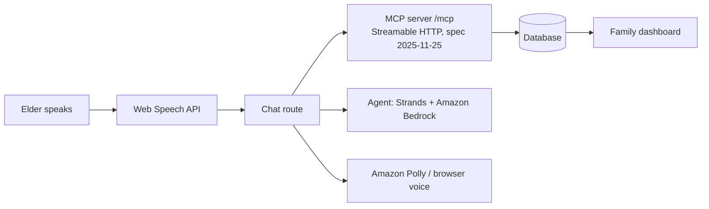

# careloop
Voice-first AI care companion for elders living alone. Self-hosted MCP server (Alexa+ track) with 8 care tools, multilingual voice, and a family dashboard.
# CareLoop: Voice Care Companion

A voice-first AI care companion for elders who live alone. She just talks: "I took my Metformin", "I skipped lunch", "I feel lonely today", "I drank two glasses of water". CareLoop logs it, replies in a warm voice in her own language, and alerts her family when something looks wrong.

Built for the **Amazon Developer Hackathon**, **Alexa+ track**, with the **AWS Builder** and **Open Source** mini challenges.

**Live demo:** https://YOUR-APP.vercel.app
**Demo video:** YOUR_YOUTUBE_LINK

> Open the live demo in **Chrome** and allow the microphone. The demo uses built-in sample data for one fictional person, Margaret. CareLoop is not medical advice. It only logs, summarizes and alerts family.

## What it does
- Talk or type. Your words appear live in the chat box while you speak, and you can edit them before sending
- Spoken replies and subtitles in English, Hindi, Tamil, Telugu and more
- Tracks medicines, meals, mood, water and appointments, and shows every tool call as a chip
- Detects problems in the routine (missed medicine, skipped meals, low mood trend) and alerts family
- Family dashboard: mood chart, medication adherence, alerts
- One-click "Run demo scenario" that replays a missed-medicine day

## Architecture



## MCP tools (8)
| Tool | Purpose |
|---|---|
| `log_medication` | Record a medicine taken or missed |
| `get_care_plan` | Today's schedule: medicines, meals, appointments |
| `daily_checkin` | Save mood, meals eaten and notes |
| `get_wellness_summary` | Plain-language summary of the last 7 days |
| `detect_anomalies` | Flag missed medicines or meals, low mood trend, inactivity |
| `log_hydration` | Record glasses of water |
| `add_appointment` | Save a doctor visit or appointment |
| `alert_family` | Notify family when something looks wrong |

The tools are defined in `src/lib/tools.ts` and served at `/mcp` over Streamable HTTP.

## Run it locally
```bash
git clone https://github.com/YOUR_USERNAME/careloop.git
cd careloop
npm install
echo "DATABASE_URL=file:./local.db" > .env.local
npm run dev
```
Open http://localhost:3000 in **Chrome**.

Check the MCP server with the MCP Inspector:
```bash
npx @modelcontextprotocol/inspector
```
Choose **Streamable HTTP**, enter `http://localhost:3000/mcp`, then **List Tools**. You should see all eight.

## Try these sentences
- "I took my Metformin this morning"
- "What medicines do I have today?"
- "I had breakfast but I skipped lunch"
- "I am feeling a little lonely today"
- "I drank two glasses of water"
- "I have a doctor visit on Friday"
- "How was my week?"
- "I am not feeling well, please tell my family"

## Environment variables
| Variable | Meaning |
|---|---|
| `DATABASE_URL` | Optional. Local database file, for example `file:./local.db`. Without it, the app uses an in-memory database seeded with demo data |
| `USE_MOCK_LLM` | `true` (default) runs everything without AWS credentials |
| `AWS_REGION`, `AWS_ACCESS_KEY_ID`, `AWS_SECRET_ACCESS_KEY` | Optional. Enables real Amazon Bedrock and Polly |

## Deploy on Vercel
1. Import this repository at vercel.com
2. Add the variable `USE_MOCK_LLM` = `true`
3. Click Deploy

## AWS services
- **Amazon Bedrock (Claude) through the Strands Agents SDK:** anomaly detection and warm summaries over the last 7 days of data
- **Amazon Polly (neural voices):** natural spoken replies, with a browser-voice fallback

Without AWS credentials, CareLoop runs in mock mode with the same tools and replies.

## Tests
```bash
npm test
```

## Tech stack
Next.js, TypeScript, Drizzle ORM, Tailwind CSS, Model Context Protocol, Web Speech API, Amazon Bedrock, Strands Agents, Amazon Polly.

## License
MIT
